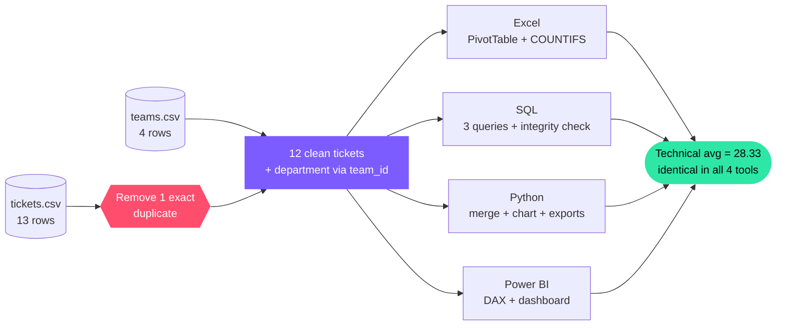
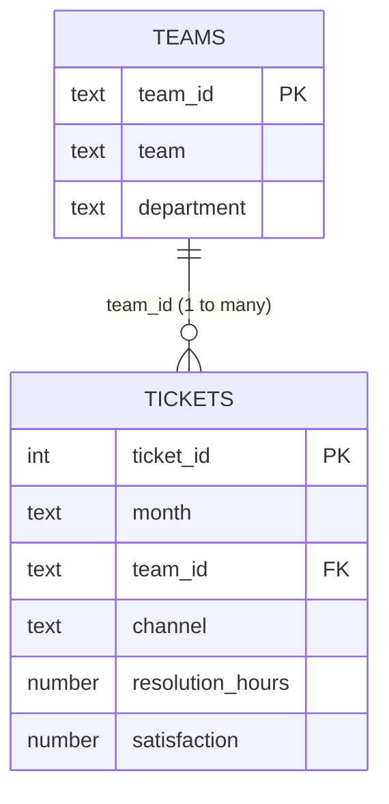
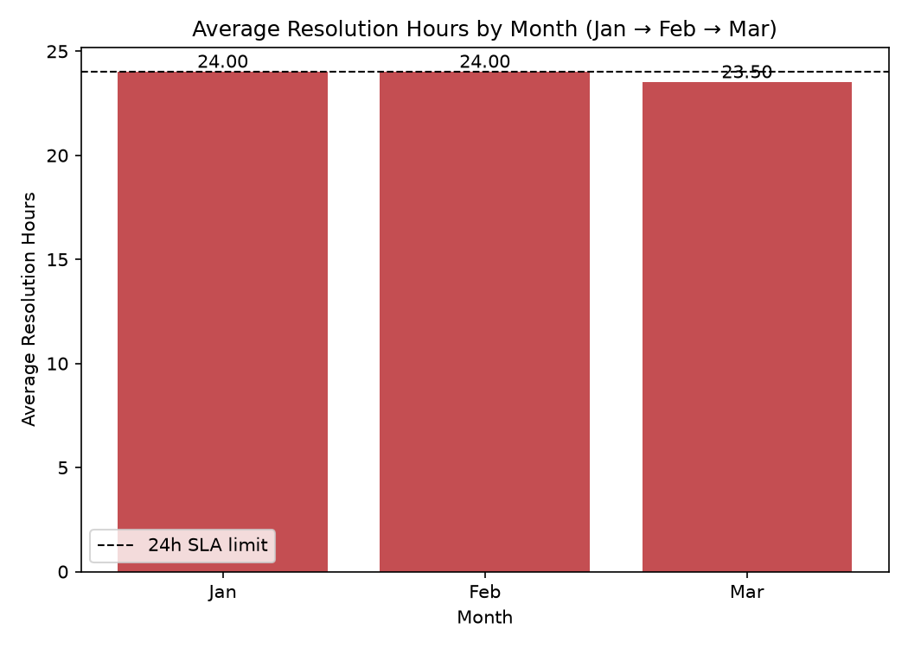

<div align="center">


<br>


| 👤 Student | 🆔 GR ID | 📝 Set | 🔗 Repository |
|:---:|:---:|:---:|:---:|
| **Meet Gajera** | **11997** | **Set B** — Customer Support Quality | `data-analysis-set-e-11997` |

**Final commit hash:** `PASTE_HASH_HERE`

</div>

---

## 🧭 Contents

[10-second answer](#answer) ·
[Quick start](#quickstart) ·
[Objective](#objective) ·
[Data](#data) ·
[Cleaning & metrics](#cleaning) ·
[Tools](#tools) ·
[Structure](#structure) ·
[Excel](#excel) ·
[SQL](#sql) ·
[Python](#python) ·
[Power BI](#powerbi) ·
[Findings](#findings) ·
[Reconciliation](#reconciliation) ·
[Video](#video) ·
[Troubleshooting](#troubleshooting) ·
[References](#references) ·
[Authorship](#authorship)

---

<a id="answer"></a>
## ⚡ The answer in 10 seconds

> **Fix AppSupport and BillingHelp first, and look hard at Chat.**

| 🥇 Weakest teams | 💬 Weakest channel | 😤 Why it matters |
|:---:|:---:|:---:|
| **AppSupport** & **BillingHelp**<br>tied at **66.67 %** (2 of 3 tickets each) | **Chat**<br>**75.00 %** breach (3 of 4) | Breached tickets score **2.60 ★** vs **4.29 ★** for on-time ones (r = **−0.85**) |

---

<a id="quickstart"></a>
## 🚀 Quick start (reproduce everything in 4 commands)

```bash
git clone https://github.com/meet6949/data-analysis-set-e-11997.git
cd data-analysis-set-e-11997

pip install -r requirements.txt
python python/analysis.py                                  # Python outputs
sqlite3 outputs/support.db < sql/setup.sql                 # SQL schema + data
sqlite3 outputs/support.db < sql/queries.sql               # SQL results -> outputs/sql/
```

Excel: open `excel/analysis.xlsx` → right-click the PivotTable → **Refresh**.
Power BI: open `powerbi/dashboard.pbix` → see [refresh steps](#powerbi).

---

<a id="objective"></a>
## 🎯 1. Business Objective

Support leadership needs to know **where resolution performance is slipping**. Two questions are answered:

1. **Which department — and which team inside it — has the weakest SLA performance?**
2. **How does service quality (SLA breaches, satisfaction) change across Email, Chat and Phone?**

> ⏱️ **SLA rule:** a ticket must be resolved in **24 hours or less**. Exactly 24 h **meets** the SLA.

### How the four tools fit together



---

<a id="data"></a>
## 📂 2. Dataset & Data Dictionary

Two synthetic files supplied with the exam, stored **unchanged** in `data/raw/`. One team has many tickets.



<details>
<summary><b>📖 Full data dictionary (click to open)</b></summary>

<br>

**`data/raw/tickets.csv`** — fact table · 13 raw rows → **12 clean rows**

| Column | Type | Meaning |
|---|---|---|
| `ticket_id` | integer | Unique ticket number |
| `month` | text (ordered Jan → Feb → Mar) | Month the ticket was logged |
| `team_id` | text | Key to `teams.team_id` |
| `channel` | text | Email / Chat / Phone |
| `resolution_hours` | number | Hours taken to resolve |
| `satisfaction` | number | Customer rating, 1–5 |

**`data/raw/teams.csv`** — lookup table · 4 rows

| Column | Type | Meaning |
|---|---|---|
| `team_id` | text (PK) | T1 – T4 |
| `team` | text | AccountCare · BillingHelp · AppSupport · DeviceHelp |
| `department` | text | Service or Technical |

</details>

---

<a id="cleaning"></a>
## 🧹 3. Cleaning Steps & Metric Definitions

| Step | What was done |
|---|---|
| 🗑️ **Duplicate removal** | Row 13 (`12, Mar, T4, Phone, 24, 5`) is an exact copy of row 12. Removed in **every** module → **13 rows before, 12 after** |
| 🔤 **Data types** | `ticket_id` integer · `resolution_hours`, `satisfaction` numeric · `team_id`, `month`, `channel`, `department` text |
| 🔑 **Lookup key** | `team_id` joins tickets → teams. **0 unmatched keys** |
| 📅 **Month order** | Jan → Feb → Mar kept in every pivot and chart |

**Metric definitions**

```text
breach_flag      = 1 if resolution_hours > 24 else 0        (24 h exactly = meets SLA)
SLA breach rate  = breached tickets ÷ all tickets            (from counts, never an average of %)
```

All numbers use 2 decimals; ties for highest/lowest are all reported.

---

<a id="tools"></a>
## 🧰 4. Tools & Versions

| Tool | Version / notes |
|---|---|
| Excel | Microsoft 365 (build: `ADD_YOUR_BUILD`) — native PivotTable, `INDEX/MATCH`, `COUNTIFS`, `AVERAGEIFS` |
| SQL engine | **SQLite 3.45.1** |
| Python | 3.x (`python --version` → `ADD_YOUR_VERSION`) — `pandas`, `matplotlib` (see `requirements.txt`) |
| Power BI Desktop | `ADD_YOUR_VERSION` (Help → About) |

---

<a id="structure"></a>
## 📁 5. Project Structure

```text
data-analysis-set-e-11997/
├── README.md                     <- must be named exactly README.md
├── requirements.txt
├── .gitignore
├── assets/                       <- README graphics (must be committed!)
│   ├── hero.png
│   ├── ticket_board.png
│   ├── channel_gauges.png
│   └── hours_vs_happiness.png
├── data/raw/
│   ├── tickets.csv               <- 13 rows (incl. duplicate)
│   └── teams.csv                 <- 4 rows
├── excel/analysis.xlsx           <- Raw · Lookup · Clean · Summary
├── sql/
│   ├── setup.sql                 <- tables + 12 fact rows + 4 lookup rows
│   └── queries.sql               <- S2a · S2b · S2c · S3 checks
├── python/
│   ├── analysis.py               <- clean · merge · derive · chart · export
│   ├── readme_visuals.py         <- rebuilds the README graphics
│   └── check_readme.py           <- verifies every README image exists
├── powerbi/dashboard.pbix        <- Power Query + DAX + one-page report
└── outputs/
    ├── clean_data.csv            <- 12-row merged dataset
    ├── python_summary.csv        <- department breach summary
    ├── python_chart.png          <- monthly avg resolution hours
    ├── powerbi_dashboard.png     <- dashboard screenshot (unfiltered)
    └── sql/                      <- saved result of every query
```

---

<a id="excel"></a>
## 📗 6. Excel

`excel/analysis.xlsx`

| Sheet | What it does |
|---|---|
| **Raw** | Original 13 rows, untouched · live **before count = 13** |
| **Lookup** | The 4-row `teams.csv` |
| **Clean** | 12 unique rows · `department` via `INDEX/MATCH` on `team_id` · `breach_flag` via `=IF(E2>24,1,0)` · live **13 → 12** row counts |
| **Summary** | `COUNTIFS` breaches by channel · overall breach rate · **native PivotTable** (average `resolution_hours`, department × month, Jan → Feb → Mar) · column chart linked to the pivot |

Everything is live — right-click the PivotTable → **Refresh** after any data change.

---

<a id="sql"></a>
## 💾 7. SQL

Dialect: **SQLite 3.45.1**. Run from the repo root, **in this order**:

```bash
sqlite3 outputs/support.db < sql/setup.sql      # 1) schema + data (12 + 4 rows)
sqlite3 outputs/support.db < sql/queries.sql    # 2) queries -> outputs/sql/*.csv
```

| Query | Question | Result file |
|---|---|---|
| **S2a** | Average resolution hours by department (DESC) | `s2a_avg_resolution_by_department.csv` |
| **S2b** | Teams whose average exceeds 24 h (`GROUP BY` + `HAVING`) | `s2b_teams_breaching_sla.csv` |
| **S2c** | Top 2 channels by breach count (ties → alphabetical) | `s2c_top_channels_by_breach.csv` |
| **S3** | Integrity: `teams LEFT JOIN tickets` + unmatched-key check (0 rows) | `diagnostic_teams_left_join.csv`, `diagnostic_unmatched_keys.csv` |

`outputs/support.db` is generated locally and git-ignored.

---

<a id="python"></a>
## 🐍 8. Python

```bash
pip install -r requirements.txt
python python/analysis.py
```

Works from the repo root or from inside `python/` — paths resolve to the repo root automatically. The script asserts **12 merged rows and 0 unmatched `team_id`**, builds `breach_flag`, prints department and team summaries (numerator / denominator shown), then saves the chart and both CSVs into `outputs/`.

*(Optional)* `python python/readme_visuals.py` rebuilds the graphics in `assets/`.

**Monthly average resolution hours (Python output):**



---

<a id="powerbi"></a>
## 📊 9. Power BI

| Item | Detail |
|---|---|
| **Sources** | `data/raw/tickets.csv`, `data/raw/teams.csv` |
| **Power Query** | Types set · exact duplicate removed → 12 rows |
| **Model** | `teams[team_id]` **1 → \*** `tickets[team_id]`, single direction (teams filters tickets) |
| **Report** | 3 KPI cards · breach rate by department · monthly avg resolution hours (Jan → Feb → Mar) · channel slicer |

```text
Ticket Count     = COUNTROWS(tickets)
Avg Satisfaction = AVERAGE(tickets[satisfaction])
SLA Breach Rate  = DIVIDE(COUNTROWS(FILTER(tickets, tickets[resolution_hours] > 24)),
                          COUNTROWS(tickets), 0)
```

**🔄 Refresh after cloning:** *Home → Transform data → Data source settings → Change Source…* → point both CSVs to your local `data/raw/` → **Close & Apply → Refresh**.

**🧪 Slicer test**

| State | Ticket Count | Avg Satisfaction | SLA Breach Rate |
|---|:---:|:---:|:---:|
| Channel = **Chat** | 4 | 3.25 | 75.00 % |
| Filter cleared | 12 | 3.58 | 41.67 % |

**Dashboard (unfiltered):**


---

<a id="findings"></a>
## 💡 10. Findings & Recommendation

### 🎫 Every ticket at a glance


> Read it across: **AppSupport** and **BillingHelp** each have two red cards. **DeviceHelp**'s only breach is a 40 h ticket in February — the worst of the quarter.

### 💬 Channels


### 😤 Slow service costs satisfaction


### 🔢 The numbers behind the pictures

| Group | Tickets | Breached | Breach rate | Avg hours | Avg satisfaction |
|---|:---:|:---:|:---:|:---:|:---:|
| Service | 6 | 2 | 33.33 % | 19.33 | 3.83 |
| **Technical** | 6 | 3 | **50.00 %** | **28.33** | 3.33 |
| Email | 4 | 0 | 0.00 % | 18.00 | 4.00 |
| Phone | 4 | 2 | 50.00 % | 26.50 | 3.50 |
| **Chat** | 4 | 3 | **75.00 %** | 27.00 | 3.25 |
| **Overall** | **12** | **5** | **41.67 %** | 23.83 | 3.58 |

Team level: AccountCare **0/3** · DeviceHelp **1/3** · **BillingHelp 2/3** · **AppSupport 2/3** → two-way tie at **66.67 %**.

### ✅ Two numeric findings

1. **Technical breaches the SLA more than Service:** **50.00 %** (3 of 6) vs **33.33 %** (2 of 6); overall **41.67 %** (5 of 12).
2. **Chat is the weakest channel:** **3 breaches** (75.00 %) and the lowest satisfaction (**3.25**); Email has **0 breaches** and the highest satisfaction (**4.00**).

### 🎯 Recommendation

Put SLA-improvement effort into **AppSupport** and **BillingHelp** (the tied highest breach rate), and review how **Chat** tickets are routed and staffed. Late tickets average **2.60 ★** against **4.29 ★** on time, so cutting resolution time is the clearest route to happier customers.

### ⚠️ Limitation

Only **12 tickets over 3 months**. Results show direction, not statistical proof, and the team-level tie cannot be broken with this sample.

---

<a id="reconciliation"></a>
## 🔁 11. Cross-Tool Reconciliation

One number, four tools — **average `resolution_hours` for the Technical department** (170 ÷ 6 = 28.333…):

| Tool | Where it comes from | Value |
|---|---|:---:|
| 📗 Excel | Summary → PivotTable / `AVERAGEIFS`, Technical total | **28.33** |
| 💾 SQL | `s2a_avg_resolution_by_department.csv` | **28.33** |
| 🐍 Python | `python_summary.csv` → `avg_resolution_hours` | **28.33** |
| 📊 Power BI | Average `resolution_hours` visual filtered to Technical | **28.33** |

No rounding differences — all four agree to 2 decimals.

---

<a id="video"></a>
## 🎥 12. Video

▶️ https://drive.google.com/file/d/1S8XH1N53zYnpqOgRV8j_UTYiGU6HwWXJ/view?usp=sharing

---

<a id="troubleshooting"></a>
## 🩺 13. Troubleshooting (images not showing?)

<details>
<summary><b>Open this if a picture or diagram is blank</b></summary>

<br>

| Symptom | Cause | Fix |
|---|---|---|
| Every image broken | File is not named exactly `README.md` or is not in the repo root | Rename (e.g. `README (38).md` → `README.md`) and keep it at the root |
| One image broken | PNG missing from `assets/` | Run `python python/readme_visuals.py`, then `git add assets/` |
| Works locally, broken on GitHub | `.gitignore` blocks PNGs, or the file was never committed | Add `!assets/*.png` and `!outputs/*.png` to `.gitignore`, then `git add -f assets outputs/*.png` |
| Works on Windows, broken on GitHub | Case mismatch (`Hero.png` vs `hero.png`) — GitHub is case-sensitive | Make the filename and the README path identical, including case |
| Badges blank | No internet (shields.io is loaded online) | Reconnect; badges are cosmetic |
| Mermaid diagram shows as code | Viewer does not support Mermaid | Use GitHub or VS Code with a Mermaid preview extension |
| Contents links do nothing | Viewer ignores `<a id>` anchors | Open the README on GitHub |

**One-command check** (lists every missing, wrongly-cased or git-ignored image):

```bash
python python/check_readme.py
```

</details>

---

<a id="references"></a>
## 📚 14. References

No external code was used beyond the official pandas, matplotlib and SQLite documentation.

---

<a id="authorship"></a>
## 📝 15. Authorship Declaration

All work in this repository is my own except where cited.

<div align="center">

**Meet Gajera** · GR ID **11997** · Set B

</div>
